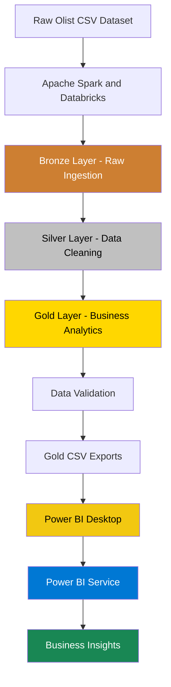
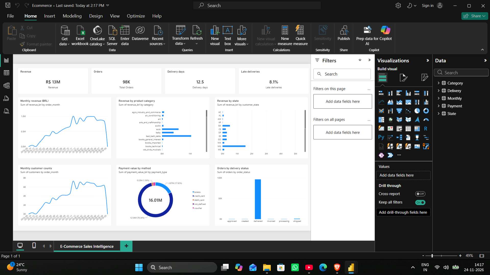

# 🛒 E-Commerce Big Data Analytics

### 🚀 End-to-End Data Engineering & Business Intelligence


---

## 🏫 Academic Details

| Particular | Details |
|------------|---------|
| University | K.R. Mangalam University |
| Program | B.Tech Computer Science and Engineering |
| Specialization | Artificial Intelligence & Machine Learning |
| Subject | Big Data Analysis with Scala and Spark Lab |
| Team Name | Data Titans |
| Academic Session | 2026–2027 |
| Project Type | Academic Team Project |

---

## 👨‍💻 Project Team

| Name | Roll Number | Role |
|------|-------------|------|
| Devansh Kumar | 2401730127 | Team Lead |
| Abhishek | 2401730058 | Team Member |
| Rohit Kumar | 2401730106 | Team Member |
| Jatin | 2401730037 | Team Member |

---

## 📌 Project Overview

This project presents an end-to-end Big Data Analytics solution for the e-commerce industry using the Brazilian Olist E-Commerce Dataset.

The project leverages Apache Spark and Databricks to process, clean, transform, and analyze e-commerce transactional data through the Medallion Architecture.

Microsoft Power BI is used to visualize analytical results and provide meaningful insights into sales performance, customer activity, payment preferences, regional revenue, and delivery efficiency.

The primary objective is to transform raw transactional data into actionable business intelligence that supports data-driven decision-making.

---

## 🎯 Project Objectives

- Process large-scale e-commerce datasets using Apache Spark.
- Implement Bronze, Silver, and Gold data layers.
- Develop a structured ETL pipeline.
- Perform data cleaning and transformation.
- Analyze sales and revenue performance.
- Understand customer purchasing behavior.
- Evaluate delivery performance and logistics efficiency.
- Identify customer payment preferences.
- Develop an interactive Power BI dashboard.
- Publish analytical results through Power BI Service.

---

## 🛠️ Technology Stack

| Technology | Purpose |
|------------|---------|
| 🔥 Apache Spark | Distributed data processing |
| 🧱 Databricks | Data engineering and analytics |
| 🐍 Python / PySpark | Data processing and transformation |
| 🗃️ Spark SQL | Data querying and aggregation |
| 🏅 Medallion Architecture | Structured data pipeline |
| 📊 Microsoft Power BI | Business intelligence and visualization |
| ☁️ Power BI Service | Online report publishing |
| 📁 CSV | Data storage and exchange |
| 📓 Jupyter Notebooks | Data engineering implementation |
| 🐙 GitHub | Version control and documentation |

---

## 📂 Dataset Overview

The project uses the Brazilian E-Commerce Public Dataset provided by Olist through Kaggle.

The dataset contains approximately 100,000 orders placed through Brazilian marketplaces between 2016 and 2018.

### 📋 Dataset Components

| Dataset | Description |
|---------|-------------|
| Customers | Customer information |
| Orders | Order details and status |
| Order Items | Product-level transaction information |
| Order Payments | Payment methods and transaction values |
| Order Reviews | Customer ratings and reviews |
| Products | Product information |
| Sellers | Seller information |
| Geolocation | Geographic information |
| Category Translation | English product category names |

### 🔗 Dataset Source

[Brazilian E-Commerce Public Dataset by Olist](https://www.kaggle.com/datasets/olistbr/brazilian-ecommerce)

---

## 🏗️ System Architecture



---

## 🏅 Medallion Architecture

### 🥉 Bronze Layer — Raw Data Ingestion

The Bronze layer represents the initial stage of the data engineering pipeline.

- Ingestion of original CSV datasets.
- Preservation of raw transactional information.
- Initial schema inspection.
- Preparation for downstream processing.

**Bronze Orders:** 99,441 records.

### 🥈 Silver Layer — Data Cleaning & Transformation

The Silver layer focuses on improving data quality and preparing structured datasets.

- Handling missing values.
- Checking duplicate records.
- Standardizing data types.
- Processing date and timestamp columns.
- Joining relevant datasets.
- Preparing analytical features.

**Silver Orders:** 99,441 records.

**Silver Order Items:** 112,650 records.

### 🥇 Gold Layer — Business Analytics

The Gold layer contains business-oriented analytical datasets generated from processed data.

- Monthly sales analysis.
- Product category performance.
- State-wise revenue analysis.
- Customer activity analysis.
- Payment method analysis.
- Delivery performance analysis.

**Gold Order Items Fact:** 112,101 records.

---

## ⚙️ ETL Pipeline

| Stage | Description |
|-------|-------------|
| 📥 Extract | Load the original Olist CSV datasets |
| 🔄 Transform | Clean, standardize, join, and aggregate data |
| 📤 Load | Generate business-oriented Gold tables |
| 🔍 Validate | Perform data quality checks |
| 📊 Visualize | Develop the Power BI dashboard |
| ☁️ Publish | Publish the report through Power BI Service |
| 💡 Analyze | Generate meaningful business insights |

---

## 📓 Databricks Notebook Implementation

The project consists of four Databricks notebooks covering the complete data engineering workflow.

| Notebook | Purpose | Status |
|----------|---------|--------|
| 01_Bronze_Data_Ingestion.ipynb | Raw data ingestion | ✅ Executed |
| 02_Silver_Cleaning.ipynb | Data cleaning and transformation | ✅ Executed |
| 03_Gold_Analytics.ipynb | Business analytics and aggregation | ✅ Executed |
| 04_Validation.ipynb | Data quality and validation checks | ✅ Executed |

The notebooks were executed in the Databricks workspace and exported with execution outputs.

---

## 🔍 Data Validation Results

The validation stage ensures the reliability and consistency of the processed datasets.

### 📊 Actual Record Counts

| Table | Number of Records |
|-------|------------------:|
| Bronze Orders | 99,441 |
| Silver Orders | 99,441 |
| Silver Order Items | 112,650 |
| Gold Order Items Fact | 112,101 |
| Gold Monthly Sales | 24 |
| Gold Category Sales | 72 |
| Gold State Sales | 27 |
| Gold Delivery Summary | 6 |
| Gold Payment Summary | 5 |

### ✅ Validation Checks

- Table record count verification.
- Empty table checks.
- Duplicate order ID checks.
- Negative price checks.
- Negative freight value checks.
- Missing order identifier checks.

The exported Databricks notebook results confirm that the core validation checks passed successfully.

---

## 📊 Gold Layer Datasets

| File | Purpose |
|------|---------|
| gold_monthly_sales.csv | Monthly sales and customer trends |
| gold_category_sales.csv | Product category revenue |
| gold_state_sales.csv | Geographic sales performance |
| gold_payment_summary.csv | Payment method analysis |
| gold_delivery_summary.csv | Delivery performance |
| gold_order_items_fact.csv | Order-item analytical preview |

> The order-items fact CSV included in this repository contains a 1,000-row preview. The complete Gold fact table in Databricks contains 112,101 records.

---

## 📈 Power BI Dashboard

The Power BI dashboard provides a consolidated view of key e-commerce business performance indicators.

### 🔑 Key Performance Indicators

| KPI | Result |
|-----|--------|
| 💰 Total Item Revenue | Approximately R$13.49 Million |
| 📦 Total Orders | Approximately 98K |
| 🚚 Average Delivery Time | 12.5 Days |
| ⏱️ Late Delivery Rate | 8.1% |
| 💳 Total Recorded Payment Value | Approximately R$16.01 Million |

All monetary values are represented in Brazilian Real (BRL).

Item revenue and recorded payment value are separate analytical measures.

### 📉 Dashboard Visualizations

- 📈 Monthly Revenue Trend
- 🛍️ Revenue by Product Category
- 🌎 Revenue by State
- 👥 Monthly Customer Trends
- 💳 Payment Value by Payment Method
- 🚚 Orders by Delivery Status

### 🖼️ Dashboard Preview



### 🌐 Published Power BI Dashboard

[](https://app.powerbi.com/links/SlRygQmL-y?ctid=38fd5a4b-955f-455a-9ad2-d2daa5a4e4d0&pbi_source=linkShare)

The report has been successfully published to Power BI Service.

Access is available to authorized university users, subject to organizational permissions and Power BI licensing requirements.

### 📥 Download Power BI File

[Download Ecommerce Analytics Dashboard (.pbix)](04_PowerBI_Dashboard/Ecommerce_Analytics_Dashboard.pbix)

The dashboard uses imported analytical data rather than a live Databricks connection.

---

## 💡 Key Business Insights

### 💰 Revenue Analysis

The monthly revenue trend helps identify changes in sales performance and periods of increased customer demand.

### 💳 Payment Preferences

Credit cards dominate the recorded payment value, accounting for approximately 78.3% of total payment value.

### 🌎 Geographic Analysis

State-wise revenue analysis helps identify important regional markets and potential business expansion opportunities.

### 🛍️ Product Category Performance

Category-level revenue analysis helps businesses identify high-performing product segments and understand product demand.

### 🚚 Delivery Performance

The average delivery duration is approximately 12.5 days, while the late delivery rate is approximately 8.1%.

These indicators help evaluate logistics performance and identify opportunities for operational improvement.

### 👥 Customer Activity

Monthly customer trends provide insights into changes in customer participation and purchasing activity over time.

---

## 📁 Repository Structure

```text
Ecommerce-BigData-Analytics/
│
├── 02_Processed_Data/
│   ├── gold_category_sales.csv
│   ├── gold_delivery_summary.csv
│   ├── gold_monthly_sales.csv
│   ├── gold_order_items_fact.csv
│   ├── gold_payment_summary.csv
│   └── gold_state_sales.csv
│
├── 03_Databricks_Notebooks/
│   ├── 01_Bronze_Data_Ingestion.ipynb
│   ├── 02_Silver_Cleaning.ipynb
│   ├── 03_Gold_Analytics.ipynb
│   └── 04_Validation.ipynb
│
├── 04_PowerBI_Dashboard/
│   └── Ecommerce_Analytics_Dashboard.pbix
│
├── 05_Project_Report/
│
├── 06_Presentation/
│
├── 07_Screenshots/
│   └── PowerBI_Dashboard_Saved.png
│
└── README.md
```

The original raw dataset can be downloaded from the Kaggle source mentioned above.

---

## 🚀 Getting Started

### Step 1 — Clone the Repository

```bash
git clone https://github.com/DevanshKumar01/Ecommerce-BigData-Analytics.git
```

### Step 2 — Download the Dataset

Download and extract the Brazilian Olist E-Commerce Dataset from Kaggle.

### Step 3 — Configure Databricks

- Create or open a Databricks workspace.
- Upload the required CSV datasets.
- Import the Databricks notebooks.
- Configure the required dataset and table paths.

### Step 4 — Execute the Data Pipeline

Run the notebooks in the following sequence:

```text
🥉 Bronze Data Ingestion
          ↓
🥈 Silver Data Cleaning
          ↓
🥇 Gold Business Analytics
          ↓
🔍 Data Validation
          ↓
📊 Power BI Dashboard
```

### Step 5 — Open the Power BI Dashboard

- Install Microsoft Power BI Desktop.
- Open Ecommerce_Analytics_Dashboard.pbix.
- Explore the available visualizations.
- Configure data source paths if required for refresh.

Alternatively, access the published report through the Power BI Service link provided above.

---

## 🏆 Project Achievements

- ✅ Implemented a structured data engineering pipeline.
- ✅ Processed approximately 100,000 e-commerce orders.
- ✅ Implemented Bronze, Silver, and Gold architecture.
- ✅ Executed four Databricks notebooks.
- ✅ Completed core data validation checks.
- ✅ Generated six analytical Gold datasets.
- ✅ Developed an interactive Power BI dashboard.
- ✅ Published the report through Power BI Service.
- ✅ Created comprehensive project documentation.
- ✅ Organized the project through GitHub.

---

## ⚠️ Project Limitations

- The dataset represents historical Brazilian e-commerce transactions from 2016 to 2018.
- The current pipeline uses batch processing rather than real-time streaming.
- The Power BI dashboard uses imported analytical data.
- The repository contains a preview of the complete Gold order-items fact table.
- Online dashboard access depends on organizational permissions and licensing.

---

## 🔮 Future Enhancements

- Real-time data processing using Apache Kafka.
- Automated ETL pipelines.
- Live Databricks and Power BI integration.
- Machine learning-based sales forecasting.
- Customer segmentation using clustering.
- Product recommendation systems.
- Delivery delay prediction.
- Advanced business intelligence dashboards.
- Automated data quality monitoring.

---

## 📝 Conclusion

This project demonstrates the practical implementation of Big Data Analytics using Apache Spark, Databricks, Medallion Architecture, and Microsoft Power BI.

By transforming raw e-commerce data into structured analytical datasets, the project provides meaningful insights into sales performance, customer activity, payment preferences, regional revenue, and delivery efficiency.

The successful execution of Databricks notebooks, completion of core validation checks, and publication of the Power BI dashboard demonstrate an end-to-end data engineering and business intelligence workflow.

This project also provides practical experience in distributed data processing, ETL development, data transformation, data validation, and business intelligence.

---

## 📚 References

- [Olist E-Commerce Dataset](https://www.kaggle.com/datasets/olistbr/brazilian-ecommerce)
- [Apache Spark Documentation](https://spark.apache.org/docs/latest/)
- [Databricks Documentation](https://docs.databricks.com/)
- [PySpark Documentation](https://spark.apache.org/docs/latest/api/python/)
- [Microsoft Power BI Documentation](https://learn.microsoft.com/en-us/power-bi/)
- [GitHub Documentation](https://docs.github.com/)

---

## 🙏 Acknowledgements

We sincerely thank K.R. Mangalam University and our faculty members for their guidance and support throughout this academic project.

We also acknowledge Olist for providing the publicly available e-commerce dataset and the Apache Spark, Databricks, and Microsoft Power BI communities for their documentation and analytical tools.

---

## 📜 Disclaimer

This project has been developed for academic and educational purposes under the subject Big Data Analysis with Scala and Spark Lab.

The original dataset belongs to its respective owners and is acknowledged through the provided source.

---

<div align="center">

## ⭐ Thank You for Visiting Our Repository!

If you find this project useful, consider giving it a star.

### 💻 Built with Data, Logic & Innovation

**TEAM DATA TITANS**

**Devansh Kumar | Abhishek | Rohit Kumar | Jatin**

🎓 K.R. Mangalam University

🛒 E-Commerce Analytics • 🔥 Apache Spark • 📊 Power BI


</div>
