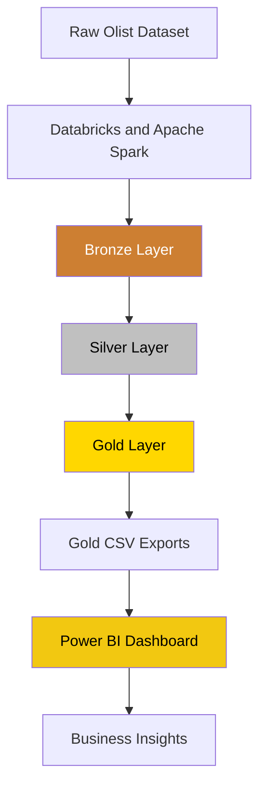

# 🛒 E-Commerce Big Data Analytics

### 🚀 End-to-End Data Engineering & Business Intelligence Project


---

## 📌 Project Overview

This project presents an end-to-end Big Data Analytics solution for the e-commerce industry using the Brazilian Olist E-Commerce Dataset.

The project uses Apache Spark and Databricks for data processing, transformation, and analytical aggregation through the Medallion Architecture. Power BI is used to visualize business performance and generate actionable insights.

The primary objective is to transform raw e-commerce data into meaningful business intelligence that supports data-driven decision-making.

---

## 🎯 Project Objectives

- Process large-scale e-commerce datasets using Apache Spark.
- Implement Bronze, Silver, and Gold data layers.
- Perform data cleaning, transformation, and aggregation.
- Analyze sales, revenue, and customer behavior.
- Evaluate delivery performance and logistics efficiency.
- Understand customer payment preferences.
- Develop an interactive Power BI dashboard.
- Generate meaningful business insights.

---

## 🛠️ Technology Stack

| Technology | Purpose |
|------------|---------|
| 🔥 Apache Spark | Distributed data processing |
| 🧱 Databricks | Data engineering and analytics |
| 🐍 Python / PySpark | Data transformation |
| 🗃️ Spark SQL | Querying and aggregation |
| 🏅 Medallion Architecture | Data pipeline organization |
| 📊 Microsoft Power BI | Data visualization |
| 📁 CSV | Data storage and exchange |
| 🐙 GitHub | Version control and documentation |

---

## 📂 Dataset

The project uses the Brazilian E-Commerce Public Dataset by Olist.

The dataset contains approximately 100,000 orders placed through Brazilian marketplaces between 2016 and 2018.

### 📋 Dataset Components

| Dataset | Description |
|---------|-------------|
| Customers | Customer information |
| Orders | Order details and status |
| Order Items | Product-level order information |
| Order Payments | Payment methods and values |
| Order Reviews | Customer ratings and reviews |
| Products | Product information |
| Sellers | Seller information |
| Geolocation | Geographic information |
| Category Translation | English product category names |

🔗 Dataset Source:

https://www.kaggle.com/datasets/olistbr/brazilian-ecommerce

---

## 🏗️ System Architecture



---

## 🏅 Medallion Architecture

### 🥉 Bronze Layer — Raw Data Ingestion

The Bronze layer represents the initial stage of the data pipeline.

- Ingestion of original CSV datasets.
- Preservation of raw data.
- Initial schema inspection.
- Preparation for downstream processing.

### 🥈 Silver Layer — Data Cleaning & Transformation

The Silver layer focuses on improving data quality and preparing structured datasets.

- Handling missing values.
- Checking duplicate records.
- Standardizing data types.
- Processing date and timestamp columns.
- Joining relevant datasets.
- Preparing analytical features.

### 🥇 Gold Layer — Business Analytics

The Gold layer contains business-oriented analytical datasets.

- Monthly sales analysis.
- Product category performance.
- State-wise revenue analysis.
- Payment method analysis.
- Delivery performance analysis.
- Order-level analytical information.

---

## ⚙️ ETL Pipeline

| Stage | Description |
|-------|-------------|
| 📥 Extract | Load the original Olist CSV datasets |
| 🔄 Transform | Clean, join, and aggregate data |
| 📤 Load | Prepare analytical Gold datasets |
| 📊 Visualize | Import analytical data into Power BI |
| 💡 Analyze | Generate business insights |

---

## 📓 Databricks Notebooks

| Notebook | Purpose |
|----------|---------|
| `01_Bronze_Data_Ingestion.ipynb` | Raw data ingestion |
| `02_Silver_Cleaning.ipynb` | Data cleaning and transformation |
| `03_Gold_Analytics.ipynb` | Business analytics and aggregation |
| `04_Validation.ipynb` | Data quality and validation checks |

The repository contains prepared notebook copies. Actual executed workspace exports and validation outputs should be verified against these notebooks before final submission.

---

## 📊 Gold Layer Datasets

| File | Purpose |
|------|---------|
| `gold_monthly_sales.csv` | Monthly sales and customer trends |
| `gold_category_sales.csv` | Product category revenue |
| `gold_state_sales.csv` | Geographic sales performance |
| `gold_payment_summary.csv` | Payment method analysis |
| `gold_delivery_summary.csv` | Delivery performance |
| `gold_order_items_fact.csv` | Order-item analytical preview |

> Note: The order-items fact CSV included in the repository is a 1,000-row preview rather than the complete fact table.

---

## 📈 Power BI Dashboard

The Power BI dashboard provides a consolidated view of key e-commerce performance indicators.

### 🔑 Key Performance Indicators

| KPI | Dashboard Value |
|-----|-----------------|
| 💰 Total Revenue | Approximately R$13.49 Million |
| 📦 Total Orders | Approximately 98K |
| 🚚 Average Delivery Time | 12.5 Days |
| ⏱️ Late Delivery Rate | 8.1% |

All monetary values are represented in Brazilian Real (BRL).

### 📉 Dashboard Visualizations

- Monthly Revenue Trend
- Revenue by Product Category
- Revenue by State
- Monthly Customer Trend
- Payment Value by Payment Method
- Orders by Delivery Status

### 🖼️ Dashboard Preview


### 📥 Power BI File

[Download Power BI Dashboard](04_PowerBI_Dashboard/Ecommerce_Analytics_Dashboard.pbix)

The saved dashboard uses imported analytical data rather than a live Databricks connection.

---

## 💡 Business Insights

### 💰 Sales & Revenue Analysis

Monthly revenue trends help identify periods of higher sales activity and changes in business performance.

### 🛍️ Product Category Analysis

Category-wise revenue analysis helps identify high-performing product segments.

### 🌎 Geographic Analysis

State-wise revenue distribution helps identify important regional markets and potential growth opportunities.

### 💳 Payment Analysis

Payment method analysis provides insights into customer payment preferences and transaction patterns.

### 🚚 Delivery Performance

Delivery duration and late delivery percentages help evaluate logistics efficiency and identify improvement opportunities.

---

## 📁 Repository Structure

```text
Ecommerce-BigData-Analytics/
│
├── 02_Processed_Data/
│   ├── gold_category_sales.csv
│   ├── gold_delivery_summary.csv
│   ├── gold_monthly_sales.csv
│   ├── gold_order_items_fact.csv
│   ├── gold_payment_summary.csv
│   └── gold_state_sales.csv
│
├── 03_Databricks_Notebooks/
│   ├── 01_Bronze_Data_Ingestion.ipynb
│   ├── 02_Silver_Cleaning.ipynb
│   ├── 03_Gold_Analytics.ipynb
│   ├── 04_Validation.ipynb
│   └── DATABRICKS_UPLOAD_AND_RUN.md
│
├── 04_PowerBI_Dashboard/
│   └── Ecommerce_Analytics_Dashboard.pbix
│
├── 05_Project_Report/
│
├── 06_Presentation/
│
├── 07_Screenshots/
│   └── PowerBI_Dashboard_Saved.png
│
└── README.md
```

The original dataset can be downloaded from the Kaggle source provided above.

---

## 🚀 Getting Started

### Step 1 — Clone the Repository

```bash
git clone https://github.com/DevanshKumar01/Ecommerce-BigData-Analytics.git
```

### Step 2 — Download the Dataset

Download and extract the original Olist dataset from Kaggle.

### Step 3 — Configure Databricks

- Create or open a Databricks workspace.
- Upload the required datasets.
- Import the project notebooks.
- Configure dataset and table paths.

### Step 4 — Execute the Data Pipeline

Run the notebooks in the following sequence:

```text
Bronze Data Ingestion
        ↓
Silver Data Cleaning
        ↓
Gold Business Analytics
        ↓
Data Validation
```

### Step 5 — Open the Power BI Dashboard

- Install Microsoft Power BI Desktop.
- Open `Ecommerce_Analytics_Dashboard.pbix`.
- Explore the dashboard visualizations.
- Configure data source paths if required for refresh.

---

## 🔮 Future Enhancements

- Real-time data processing using Apache Kafka.
- Automated ETL pipelines.
- Live Databricks and Power BI integration.
- Machine learning-based sales forecasting.
- Customer segmentation using clustering.
- Product recommendation systems.
- Delivery delay prediction.
- Advanced business intelligence dashboards.

---

## 👨‍💻 Project Team

| Name | Roll Number | Role |
|------|-------------|------|
| Devansh Kumar | 2401730127 | Team Lead |
| Abhishek | 2401730058 | Team Member |
| Rohit Kumar | 2401730106 | Team Member |

### 🏫 Academic Details

- **University:** K.R. Mangalam University
- **Program:** B.Tech Computer Science and Engineering
- **Specialization:** Artificial Intelligence & Machine Learning
- **Subject:** Big Data Analytics
- **Project Type:** Academic Team Project
- **Academic Year:** 2026–2027

---

## 📚 References

- [Olist E-Commerce Dataset](https://www.kaggle.com/datasets/olistbr/brazilian-ecommerce)
- [Apache Spark Documentation](https://spark.apache.org/docs/latest/)
- [Databricks Documentation](https://docs.databricks.com/)
- [Microsoft Power BI Documentation](https://learn.microsoft.com/en-us/power-bi/)
- [PySpark Documentation](https://spark.apache.org/docs/latest/api/python/)

---

## 🙏 Acknowledgements

We acknowledge Olist for providing the publicly available e-commerce dataset and the Apache Spark, Databricks, and Microsoft Power BI communities for their documentation and analytical tools.

We also thank our university and faculty members for their guidance and support throughout this academic project.

---

## 📜 Disclaimer

This project has been developed for academic and educational purposes. The original dataset belongs to its respective owners and is acknowledged through the provided source.

---

<div align="center">

### ⭐ If you find this project useful, consider starring the repository!

### 💻 Built with Data, Logic & Innovation

**Team Data Titans | K.R. Mangalam University**

🛒 E-Commerce Analytics • 🔥 Apache Spark • 📊 Power BI

</div>
